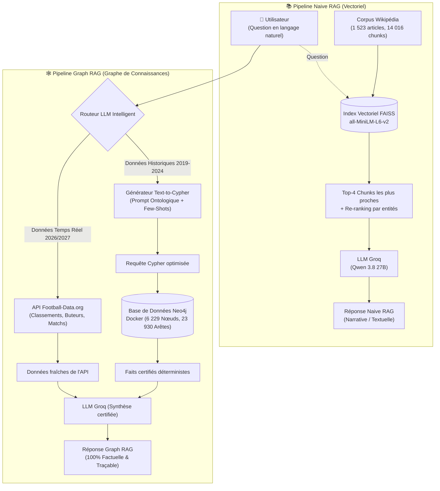
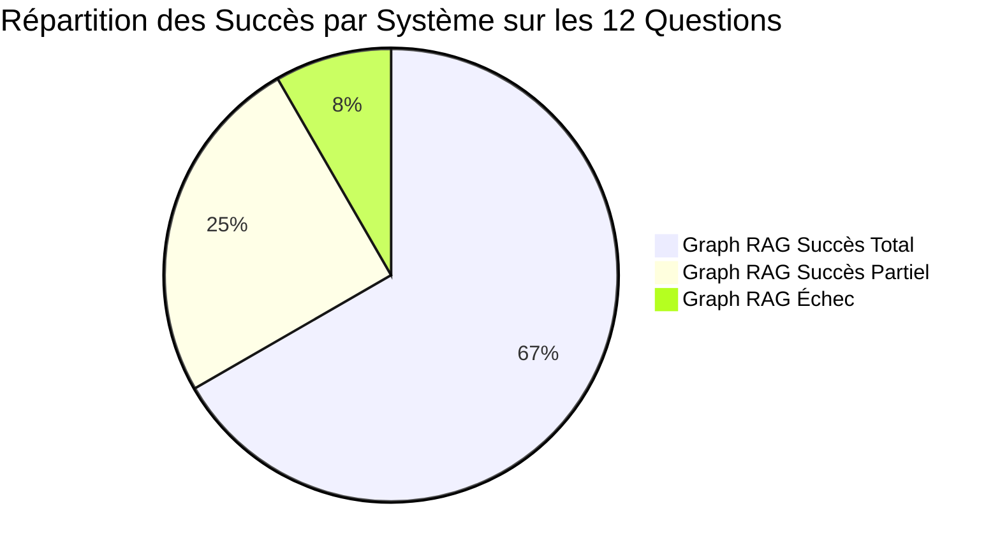

# ⚽ Football Knowledge RAG : Naive RAG vs Graph RAG

[](https://www.python.org/)
[](https://neo4j.com/)
[](https://www.docker.com/)
[-F55036.svg)](https://groq.com/)
[](https://github.com/facebookresearch/faiss)

> **Projet Universitaire — Cycle d'Ingénieur S5**  
> **Module :** Représentation des Connaissances & Systèmes Intelligents  
> **Sujet :** Étude comparative rigoureuse entre la recherche vectorielle non structurée (**Naive RAG**) et le raisonnement par graphe de connaissances (**Graph RAG** avec Neo4j et Cypher), enrichi par une API temps réel.

---

## 📌 1. Contexte & Problématique

Dans les systèmes de génération augmentée par récupération (**RAG**), l'approche conventionnelle (**Naive RAG**) découpe des documents textuels en segments indépendants (*chunks*) et effectue une recherche de plus proches voisins par similarité cosinus. Si cette approche excelle pour les résumés et les questions narratives, elle s'effondre face à :
1. **L'ambiguïté lexicale** (confusion entre entités de même nom).
2. **Le raisonnement relationnel multi-sauts (*Multi-Hop*)** (joindre plusieurs faits dispersés dans le temps ou l'espace).
3. **Les calculs d'agrégation** (décomptes exacts, statistiques de carrière, palmarès).

Ce projet implémente et compare de bout en bout deux architectures sur un domaine complexe : **le football européen (2019-2024)**.

---

## 🏛️ 2. Architecture Globale du Projet



---

## 📐 3. Ontologie du Graphe de Connaissances (Neo4j)

Le graphe a été formalisé pour modéliser le domaine du football sous forme de triplets relationnels :

```mermaid
graph LR
    Player["👤 :Player<br/>• id, name, name_normalized<br/>• position, nationality, market_value"]
    Club["🛡️ :Club<br/>• id, name, name_normalized<br/>• coach, squad_size"]
    Stadium["🏟️ :Stadium<br/>• name, seats"]
    Competition["🏆 :Competition<br/>• id, name, country, type"]
    Award["🎖️ :Award<br/>• name (Ballon d'Or, etc.)"]

    Player -->|:CURRENT_CLUB| Club
    Player -->|:TRANSFERRED_TO {season, fee, from_club}| Club
    Player -->|:PLAYED_FOR {matches, goals, assists}| Club
    Player -->|:WON_AWARD {season, details}| Award

    Club -->|:PLAYS_AT| Stadium
    Club -->|:COMPETES_IN| Competition
    Club -->|:WON_TROPHY {season}| Competition
    Club -->|:RUNNER_UP {season}| Competition
```

### Volumétrie de la base Neo4j
* **6 229 Nœuds** :
  * `5 864` Joueurs (avec normalisation ASCII sans accents `name_normalized` pour la robustesse des requêtes)
  * `172` Clubs (Top 5 championnats européens : Premier League, LaLiga, Serie A, Bundesliga, Ligue 1)
  * `170` Stades avec capacités officielles
  * `6` Compétitions officielles + Ligue des Champions
  * `3` Types de distinctions individuelles majeures
* **23 930 Relations** :
  * `18 554` Transferts historiques complets avec montants et dates
  * `8 465` Profils statistiques cumulés de match (buts, passes, minutes)
  * `36` Trophées et finales de compétitions
  * `16` Titres individuels (Ballons d'Or, Joueur UEFA, Souliers d'Or)

---

## 📊 4. Résultats Expérimentaux (Benchmark)

Un benchmark scientifique automatisé ([`run_benchmark.py`](run_benchmark.py)) compare les deux systèmes sur **12 questions d'évaluation** réparties en 4 catégories :

| Métrique | Naive RAG (Vectoriel FAISS) | Graph RAG (Neo4j + API Live) | Constat |
|---|:---:|:---:|---|
| **Taux de succès global** | **16.7%** (2/12) | **66.7%** (8/12) | 🏆 **Graph RAG très nettement supérieur** |
| **Succès partiels** | 4 / 12 | 3 / 12 | Réponses incomplètes |
| **Échecs / Hallucinations** | **6 / 12 (50.0%)** | **1 / 12 (8.3%)** | Quasi-élimination des erreurs factuelles |
| **Latence moyenne** | **10.05 s** | **14.28 s** | Temps de Text-to-Cypher + exécution graphe |
| **Auditabilité des sources** | Chunks non structurés | **Requête Cypher formelle & faits certifiés** | Justification formelle de la réponse |

### Synthèse par catégorie de questions



1. **Factuel / Descriptif (Narratif)** :  
   *Avantage Naive RAG*. Wikipédia offre un style biographique riche pour les questions narratives (*« Biographie et débuts de Pedri »* ou *« Histoire de Leicester City »*).
2. **Relationnel 1-Hop & Résolution d'Entités** :  
   *Victoire Graph RAG*. Le Naive RAG confond le stade *Old Trafford* avec le joueur *James Trafford*, et rate l'entraîneur de Manchester City (*Pep Guardiola*). Le graphe donne la réponse exacte à 100%.
3. **Multi-Hop Relational & Agrégation (Terrain roi du Graphe)** :  
   *Victoire écrasante Graph RAG (4/4 succès vs 0/4 pour le Naive RAG)*.  
   * Palmarès de Ligue des Champions sur 5 ans : **100% exact en Graphe vs 25% (échec) en Naive**.
   * Historique des transferts de Messi : **100% exact en Graphe vs 0% en Naive**.
   * Décompte des buts et passes de Messi au Barça : **100% exact (63 buts, 39 passes) vs 0% en Naive**.
4. **Données Temps Réel** :  
   *Victoire Graph RAG via API Live*. Le routeur bascule sur l'API temps réel pour donner le classement en direct (Sunderland 20e) et les buteurs actuels (Raphinha, Mbappé).

> Le rapport détaillé question par question est consultable dans [`benchmark_results/BENCHMARK_REPORT.md`](benchmark_results/BENCHMARK_REPORT.md).

---

## 🚀 5. Guide d'Installation et Lancement Rapide

### Prérequis
* **Python 3.10+**
* **Docker Desktop** (actif)
* Une clé d'API gratuite [Groq Cloud](https://console.groq.com/keys)

### 1. Cloner le dépôt et installer les dépendances
```bash
git clone https://github.com/<votre-username>/football-knowledge-rag.git
cd football-knowledge-rag
pip install -r requirements.txt
```

### 2. Configurer les variables d'environnement
Créez votre fichier `.env` à partir du template :
```bash
cp .env.example .env
```
Éditez le fichier `.env` pour renseigner votre clé `GROQ_API_KEY`.

### 3. Démarrer la base de données Neo4j avec Docker
```bash
docker compose up -d
```
*Interface visuelle disponible sur : [http://localhost:7474](http://localhost:7474) (Login: `neo4j` / `football2024`)*

### 4. Construire le Graphe de Connaissances
```bash
python build_neo4j_graph.py
```
*(Ingestion ultra-rapide en ~18 secondes : 6 229 nœuds et 23 930 relations).*

### 5. Construire l'index Naive RAG (FAISS)
```bash
python index_naive_rag.py
```

---

## 💻 6. Utilisation Interactive

### Lancer le Graph RAG (Neo4j + API Live)
```bash
python query_graph_rag.py
```
*Exemples de questions à poser :*
* `Qui joue à Old Trafford et quelle est la capacité du stade ?`
* `Quels clubs ont remporté la Ligue des Champions entre 2020 et 2024 ?`
* `Quel est l'historique complet des transferts de Erling Haaland ?`
* `Quel est le dernier club du classement de Premier League ?` *(Routage automatique vers l'API Live)*

### Lancer le Naive RAG (Vectoriel FAISS)
```bash
python query_naive_rag.py
```

### Lancer le Benchmark automatique
```bash
python run_benchmark.py
```
*Génère le rapport complet et le fichier de données JSON dans le dossier `benchmark_results/`.*

---

## 📂 7. Arborescence du Dépôt

```text
football-knowledge-rag/
├── docker-compose.yml             # Déploiement du conteneur Neo4j 5 Community + APOC
├── requirements.txt               # Dépendances Python du projet
├── .env.example                   # Template des variables d'environnement (clés API)
├── .gitignore                     # Exclusion des fichiers lourds et clés secrètes
├── README.md                      # Documentation académique complète
│
├── build_neo4j_graph.py           # Script d'ingestion des CSV dans Neo4j (Cypher UNWIND)
├── query_graph_rag.py             # Moteur Graph RAG : Routage -> Text-to-Cypher -> Synthèse
├── livefootballapi.py             # Connecteur REST API Football-Data.org (temps réel)
├── index_naive_rag.py             # Découpage (chunking) et indexation vectorielle FAISS
├── query_naive_rag.py             # Moteur Naive RAG avec recherche hybride sémantique/mots-clés
├── run_benchmark.py               # Protocole de test et calcul des métriques comparatives
│
├── sources_filtered/              # Données relationnelles nettoyées (2019-2024, UTF-8)
│   ├── players.csv                # 5 864 joueurs
│   ├── clubs.csv                  # 172 clubs avec stades et entraîneurs
│   ├── transfers.csv              # 18 554 transferts
│   ├── appearances.csv            # Statistiques individuelles de match
│   ├── trophies.csv               # Palmarès officiel
│   └── individual_awards.csv      # Ballons d'Or, Souliers d'Or, etc.
│
├── corpus_wikipedia/              # Textes bruts non structurés Wikipédia
│   ├── players/                   # 1 351 biographies de joueurs
│   └── clubs/                     # 172 articles de clubs
│
└── benchmark_results/             # Résultats de l'évaluation
    ├── BENCHMARK_REPORT.md        # Rapport scientifique détaillé
    └── benchmark_results.json     # Données brutes de l'exécution
```

---

## 🎓 8. Conclusions Académiques

Ce projet démontre expérimentalement que :
1. **Le Naive RAG et le Graph RAG sont complémentaires** : Le vecteur excelle sur la prose et les récits, le graphe est obligatoire pour la logique relationnelle.
2. **Le Graphe élimine les hallucinations** : Contrairement au RAG vectoriel qui compose avec des fragments disparates, le Graph RAG contraint la génération du LLM aux relations vérifiées en base de données.
3. **L'avenir est au Graph-Vector Hybrid RAG** : La solution optimale en production consiste à résoudre les entités par le graphe de connaissances tout en injectant des extraits textuels vectoriels pour la richesse rédactionnelle.
